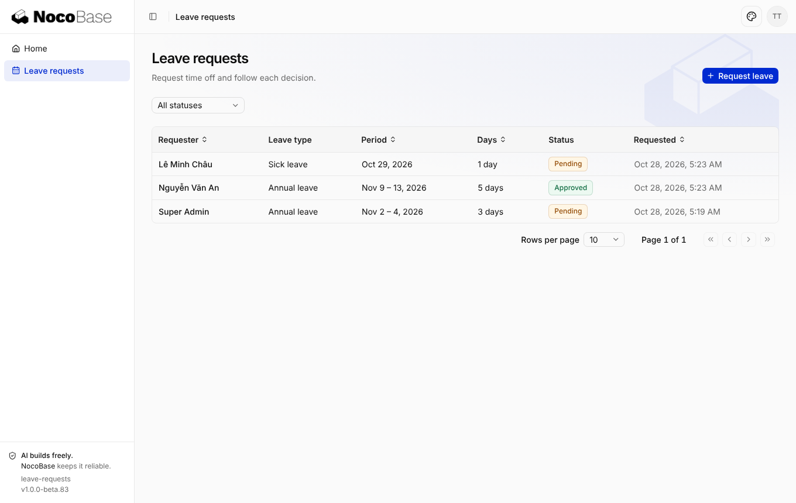
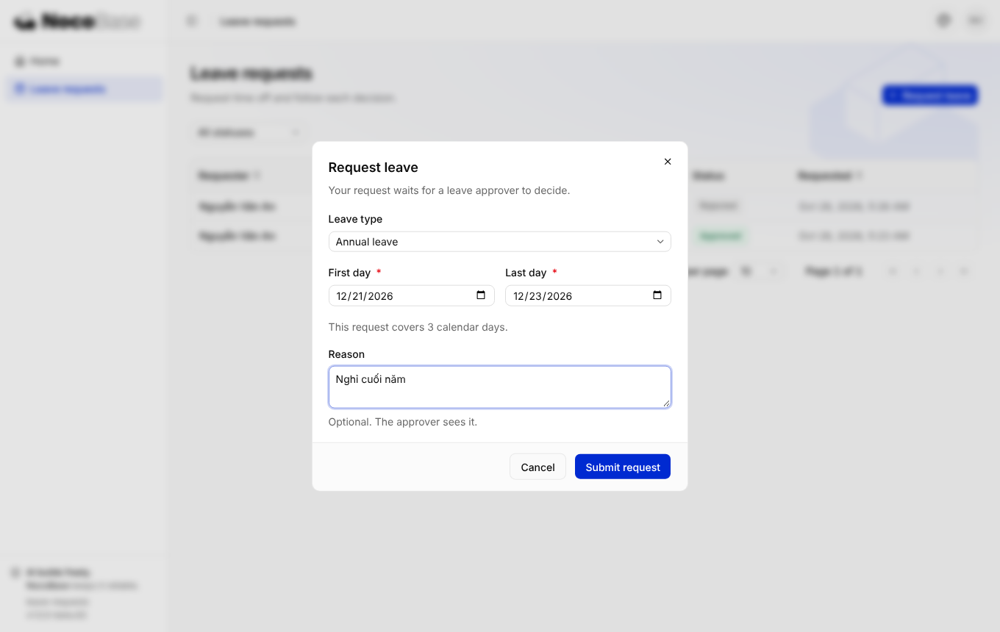
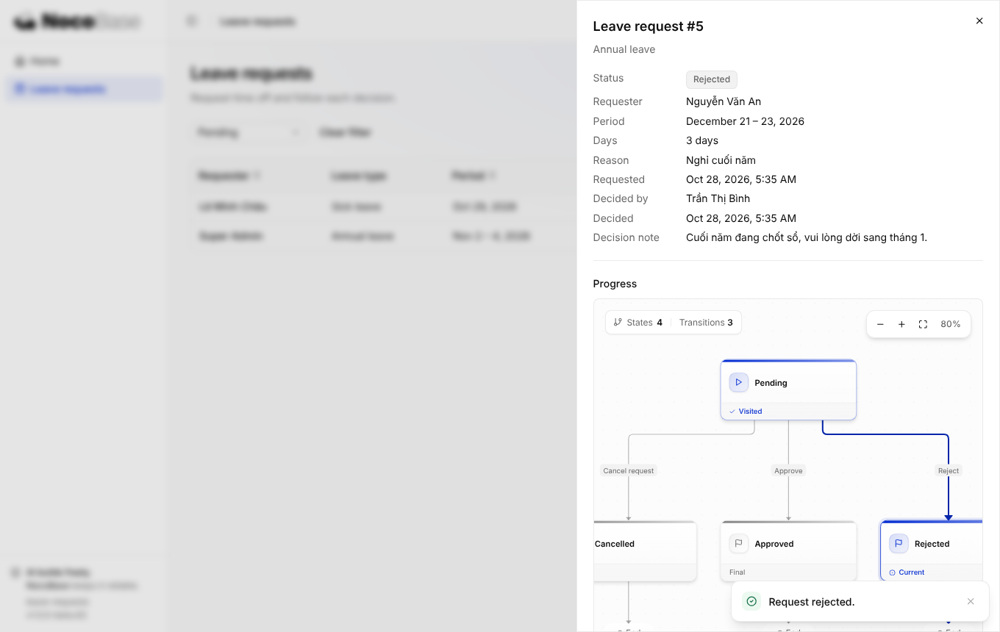
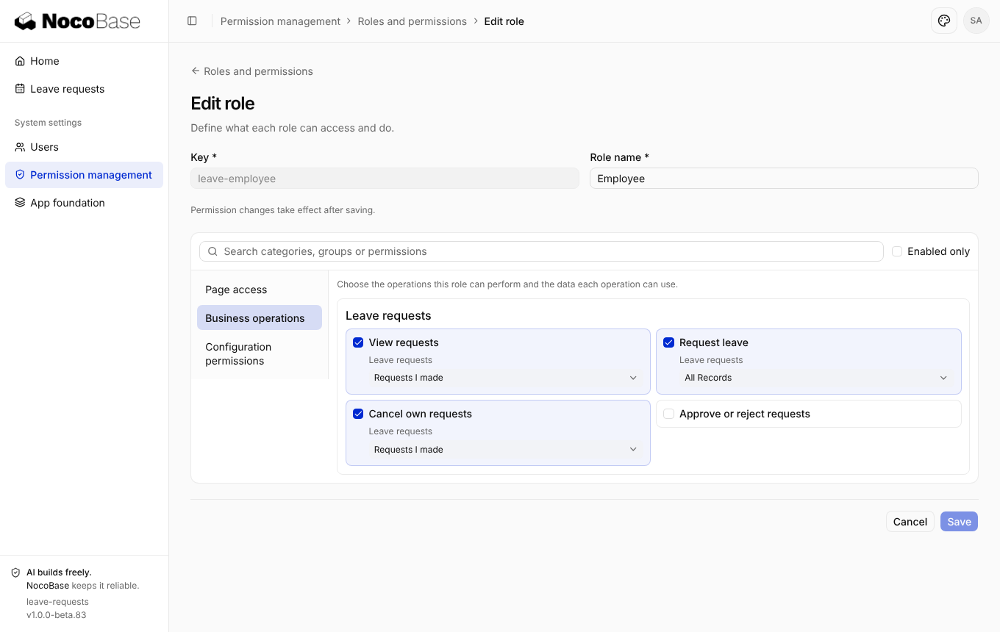

# Thử nghiệm NocoBase 3: app "Đơn nghỉ phép"

Repo này chứa một app NocoBase 3 (bản beta) dựng từ đầu, đi theo đúng quy trình mà NocoBase 3 thiết kế: một coding agent đọc `AGENTS.md` và các Skills của app, rồi viết code vào repo.

App nằm trong thư mục [`leave-requests/`](leave-requests/), tạo từ template `@nocobase/app-template-default@1.0.0-beta.83`, với `@nocobase/app-server` 3.0.0-beta.3.

## App làm được gì

- **Nhân viên** tạo đơn nghỉ phép (phép năm / ốm / không lương). Ngày bắt đầu và kết thúc được kiểm tra, số ngày tự tính. Nhân viên chỉ thấy đơn của chính mình và có thể hủy đơn khi đơn còn chờ duyệt.
- **Người duyệt nghỉ phép** thấy tất cả đơn và có thể duyệt hoặc từ chối. Khi từ chối thì bắt buộc ghi lý do. Không ai được tự duyệt đơn của mình, kể cả admin.
- Trạng thái đơn chạy theo **record lifecycle** (`@nocobase/lifecycle`): chờ duyệt → đã duyệt / bị từ chối / đã hủy. Mỗi lần chuyển trạng thái đều được ghi lịch sử, và màn hình chi tiết vẽ sơ đồ quy trình.
- **Phân quyền** gồm hai vai trò "Employee" và "Leave approver", được seed sẵn khi cài mới. Admin có thể chỉnh vai trò và gán cho người dùng trong *System settings → Users / Permission management*.
- Giao diện có tiếng Anh và tiếng Trung, là hai ngôn ngữ template hỗ trợ sẵn.

| Danh sách (người duyệt) | Tạo đơn (nhân viên) |
| --- | --- |
|  |  |
| **Từ chối kèm lý do + sơ đồ lifecycle** | **Phân quyền nghiệp vụ theo vai trò** |
|  |  |

## Chạy thử

Cần Node.js 24 trở lên và pnpm 11.

Cài dependency:

```bash
cd leave-requests && pnpm install
```

Tạo `config.yml` (dùng SQLite):

```bash
pnpm nocobase config init
```

Chạy migration và seed:

```bash
pnpm nocobase db apply
```

Khởi động dev server:

```bash
pnpm dev
```

Mở URL `Local:` mà lệnh `pnpm dev` in ra (mặc định `http://127.0.0.1:13000/main/`) rồi đăng nhập bằng `nocobase` / `admin123`. Sau đó vào *System settings → Users* để tạo người dùng và gán vai trò *Employee* hoặc *Leave approver*.

Chạy test:

```bash
pnpm test
```

## Code chính

| Phần | File |
| --- | --- |
| Lifecycle (trạng thái, guard) | `leave-requests/server/lifecycles/leave-requests.ts` |
| Phân quyền (composite resource, phạm vi "đơn của tôi") | `leave-requests/server/leave-requests/permissions.ts` |
| Service + HTTP API (Hono) | `leave-requests/server/leave-requests/service.ts`, `leave-requests/server/routes/leave-requests.ts` |
| Migration, seed vai trò | `leave-requests/database/main/` |
| Giao diện (React, shadcn/ui) | `leave-requests/client/pages/leave-requests/` |
| Test | `leave-requests/tests/{server,database}/leave-*.test.ts` |
| Ghi chú cho agent sau | `leave-requests/.agents/rules/leave-requests.md` |
